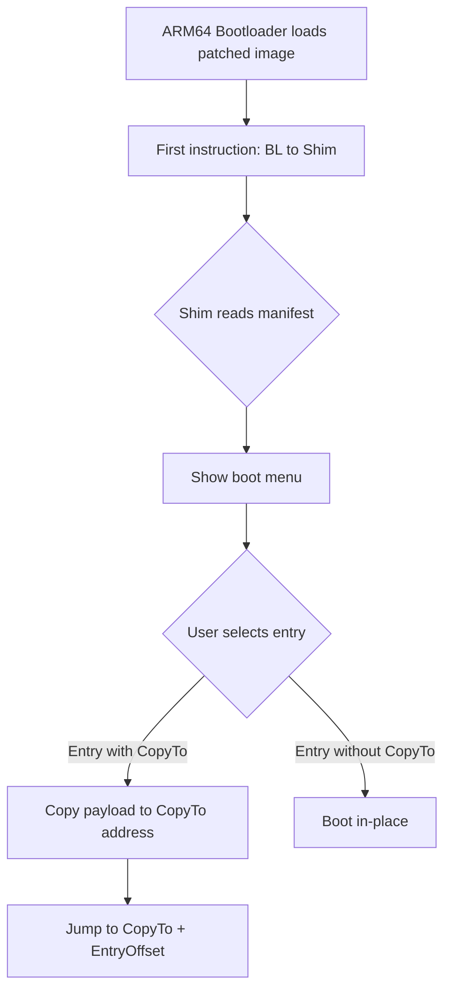

# Configuration Format

Multi-Boot Kernel Patcher uses INI-style configuration files to describe how a
patched kernel image is assembled. This document covers every section, key, and
validation rule the patcher implements.

## Overview

A configuration file defines a `[Pack]` section for global settings, one or more
`[Image-*]` sections for bootable payloads, and an optional `[Manifest]` section
to emit a reversible boot manifest.

```
[Pack]            ← Global: shim path, output, timeout
  ↓
[Image-*] ...     ← Payload entries (kernel, DTB, UEFI, etc.)
  ↓
[Manifest]        ← Optional: embed reversible manifest (must be last)
```

::: tip
All relative paths in the config are resolved relative to the configuration
file itself, not the current working directory.
:::

## File Structure

A configuration file has up to three kinds of sections:

| Section | Required | Purpose |
|---------|----------|---------|
| `[Pack]` | Yes | Global pack settings: shim path, output, timeout |
| `[Image-*]` | At least one | Individual payload entries (kernel, DTB, UEFI, etc.) |
| `[Manifest]` | No | Marks the end of the file; emits a reversible boot manifest |

::: danger
Section names are case-sensitive. Image sections must start with `Image-`
followed by at least one character (`[Image]`, `[Image-A]`, `[Image-UEFI]` are
all valid). The parser rejects duplicate values for the same key within a section.
:::

## `[Pack]` Section

The `[Pack]` section contains global patcher settings.

```ini
[Pack]
Shim=../build/Shims/Shim.AYAPS.bin
Output=../build/PatchedKernel
Default=Image
Timeout=0
```

### Keys

| Key | Required | Default | Description |
|-----|----------|---------|-------------|
| `Shim` | Yes | — | Absolute or relative path to the compiled Shim binary. Relative to this `.cfg`. |
| `Output` | Yes | — | Absolute or relative path where the patched image is written. |
| `Default` | No | First `BaseImage` entry | Section name of the entry selected by default in the boot menu. |
| `Timeout` | No | `0` | Boot menu timeout in milliseconds. `0` waits indefinitely for user input. |

### Validation

- `Shim` and `Output` must both be non-empty after path resolution.
- `Default` must reference an existing `[Image-*]` section; if omitted, the first
  entry marked `BaseImage=true` is used.

## `[Image-*]` Sections

Each payload is defined in one section. Names must begin with `Image-`.

### Example

```ini
[Image]
Name=Android/Linux
Path=/path/to/Image
Type=Linux
BaseImage=true
Align=21

[Image-UEFI]
Name=UEFI
Path=/path/to/SM8550_EFI.fd
Type=FreeExec
BaseImage=false
CopyTo=0xC7CC0000
CopySizeMax=0x00400000
EntryOffset=0

[Image-DTB]
Name=Linux Device Tree
Path=/path/to/linux.dtb
Type=DTB
BaseImage=false
```

### Required Keys

| Key | Type | Description |
|-----|------|-------------|
| `Name` | string | Human-readable label shown in the boot menu. Must be non-empty. |
| `Path` | string | Absolute or relative path to the payload file. |
| `Type` | enum | Entry type. See [Entry Types](#entry-types). |

### Optional Keys

| Key | Type | Default | Description |
|-----|------|---------|-------------|
| `BaseImage` | bool | `false` | Exactly one entry must be `true`. Must be `Type=Linux`; cannot use `CopyTo`, `CopySizeMax`, or `EntryOffset`. |
| `Align` | uint32 | `2` (4-byte) for executables, `2` for others | Alignment shift. Valid range `2`–`21` (4 bytes – 2 MiB). |
| `CopyTo` | hex uint64 | — | Load address the payload is copied to at boot. Requires `CopySizeMax`. Must be 4-byte aligned and non-zero. |
| `CopySizeMax` | hex uint64 | — | Maximum copy size when `CopyTo` is set. Must be non-zero. |
| `EntryOffset` | hex uint64 | `0` | Byte offset from `CopyTo` to the entry point. Used only with executable types. |
| `DeviceTreeBlob` | string | — | References a `Type=DTB` section by name for DTB override. Only valid on executable entries without `CopyTo`. The target DTB entry must also lack `CopyTo`. |

### Validation

::: warning
A valid image entry must have non-empty `Name`, non-empty `Path`, and a
recognized `Type`. All three are mandatory.
:::

- `Align` must be between `2` (4-byte alignment) and `21` (2 MiB alignment).
- `BaseImage=true` entries must be `Type=Linux`, cannot set `CopyTo` /
  `CopySizeMax`, and must have `EntryOffset=0`.
- `CopyTo` entries must be 4-byte aligned, non-zero, and accompanied by a
  non-zero `CopySizeMax`.
- `CopySizeMax` cannot appear without `CopyTo`.
- `DeviceTreeBlob` must reference a section with `Type=DTB` that also does not
  set `CopyTo`.

## `[Manifest]` Section

When present, it must be the **final section** in the file.

```ini
[Manifest]
Type=Manifest
```

| Key | Required | Value |
|-----|----------|-------|
| `Type` | Yes | Must be exactly `Manifest` |

::: danger Section Order
`[Manifest]` must be the last section. Any entries after it trigger a parse
error: `[Manifest] must be the final section`.
:::

The patcher embeds a reversible boot manifest into the output image. `UnpackTool`
can read this manifest to restore the original base image, payloads, and shim,
so the patched image can be reconfigured and repacked.

::: tip
No other keys are accepted in `[Manifest]`. The parser rejects `Path`, `Name`,
or any unknown property.
:::

## Entry Types

| Type String | Enum | Numeric | Description |
|-------------|------|---------|-------------|
| `Linux` | `MF_ENTRY_TYPE_LINUX` | 1 | ARM64 Linux kernel image. Contains a valid Linux header. |
| `FreeExec` | `MF_ENTRY_TYPE_FREE_EXEC` | 2 | Position-independent executable (e.g. UEFI firmware). Loaded via `CopyTo` and entered at `CopyTo + EntryOffset`. |
| `Shim` | `MF_ENTRY_TYPE_SHIM` | 3 | Reserved for internal use. The attached shim is the final automatic `Type=Shim` entry; do not add it manually. |
| `Blob` | `MF_ENTRY_TYPE_BLOB` | 4 | Raw binary blob. Cannot be executed. |
| `DTB` | `MF_ENTRY_TYPE_DTB` | 5 | Device Tree Blob. Referenced by `DeviceTreeBlob` on executable entries. |
| `Manifest` | `MF_ENTRY_TYPE_MANIFEST` | 6 | Only valid inside the `[Manifest]` section header, not as an image type. |

### Execution Flow

On boot, the patched image executes as follows:



- With `CopyTo`: copies `min(fileSize, CopySizeMax)` bytes to the target
  address, then jumps to `CopyTo + EntryOffset`.
- Without `CopyTo`: the entry stays in place; Linux kernels boot directly.
- `Blob` and `DTB` entries are never executed; they are loaded into memory
  for the kernel/UEFI to consume.

## Alignment

`Align` is stored as a power-of-two exponent, not a byte count:

| `Align` value | Alignment |
|---------------|-----------|
| `2` | 4 bytes |
| `3` | 8 bytes |
| `12` | 4 KiB |
| `21` | 2 MiB |

::: tip Default Alignment
For executable payloads (`FreeExec`), the default is `2` (4-byte alignment)
when `Align` is omitted. All other types also default to `2`.
:::

The patcher enforces this range for every entry and aligns the entry's in-manifest
offset accordingly. The ARM64 bootloader typically loads the patched image at
2 MiB alignment (`Align=21`).

## Path Resolution

Rules for `Shim`, `Output`, and `Path`:

- Paths beginning with `/` are treated as absolute and used verbatim.
- All other paths are joined with the directory containing the `.cfg` file.

### Example

```
Config file:   /home/user/MultiBootKernelPatcher/Config/Shim.AYAPS.cfg
Shim=      ../build/Shims/Shim.AYAPS.bin
Resolved:  /home/user/MultiBootKernelPatcher/build/Shims/Shim.AYAPS.bin
```

## Full Example

```ini
[Pack]
# Paths are relative to this config file's directory.
Shim=../build/Shims/Shim.AYAPS.bin
Output=../build/PatchedKernel
Default=Image
Timeout=5000

[Image]
Name=Android/Linux
Path=/path/to/Image
Type=Linux
BaseImage=true
Align=21

[Image-DTB]
Name=Linux Device Tree
Path=/path/to/linux.dtb
Type=DTB
BaseImage=false
Align=3

[Image-UEFI]
Name=UEFI
Path=/path/to/SM8550_EFI.fd
Type=FreeExec
BaseImage=false
CopyTo=0xC7CC0000
CopySizeMax=0x00400000
EntryOffset=0

[Manifest]
Type=Manifest
```

## Error Reference

Common validation errors returned by the patcher:

| Error | Cause |
|-------|-------|
| `[Pack] requires Shim and Output` | Missing required key in `[Pack]`. |
| `At least one [Image-*] section is required` | No image entries defined. |
| `[%s] requires Name, Path and Type` | A required key is empty or unrecognised. |
| `[%s] Align must be from 2 to 21` | Alignment out of range. |
| `Base image [%s] must set Type=Linux` | `BaseImage=true` with wrong type. |
| `Base image [%s] cannot set CopyTo` | Base image combined with `CopyTo`. |
| `[%s] CopyTo address must be non-zero` / `must be aligned to 4 bytes` | Invalid `CopyTo`. |
| `[%s] CopySizeMax requires CopyTo` | Stranded `CopySizeMax`. |
| `[Manifest] must be the final section` | Entries after `[Manifest]`. |
| `invalid or duplicate key [%s] %s` | Duplicate or malformed key. |

## See Also

- [Sample Config](../Config/kShim.Sample.cfg) — annotated example shipped with the project.
- `UnpackTool` — reads the manifest back out for re-packing.
